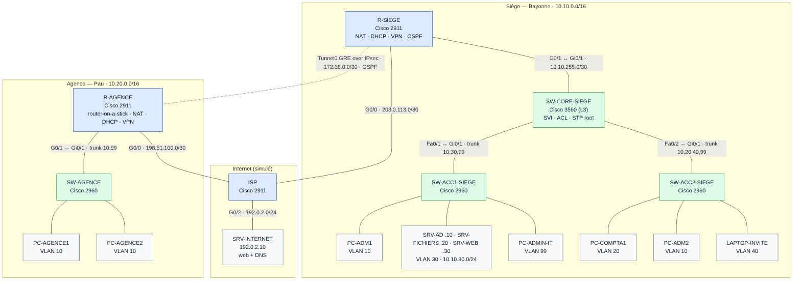

# Lab Cisco PME — Réseau d'une PME sur deux sites

[](https://github.com/ebarrault/Lab-Cisco-PME/actions/workflows/ci.yml)

Labo Packet Tracer d'une PME de ~50 postes répartie entre un **siège** (Bayonne) et une **agence** (Pau), reliés par un **VPN IPsec**. L'objectif est un réseau segmenté, routé dynamiquement, sécurisé et administrable à distance, avec une page de tests qui prouve chaque fonctionnalité.



## Ce qui est mis en œuvre

| Thème | Détail |
|---|---|
| **VLAN** | 6 VLAN (administratif, comptabilité, serveurs, invités, management, natif « parking ») ; trunks 802.1Q avec liste de VLAN autorisés |
| **Routage inter-VLAN** | deux techniques : **SVI sur commutateur de niveau 3** (siège) et **router-on-a-stick** (agence) |
| **OSPF** | zone 0 entre les deux routeurs et le cœur, **authentification MD5**, interfaces passives par défaut, route par défaut diffusée |
| **DHCP** | serveur sur les routeurs, **relais** (`ip helper-address`) sur les SVI du cœur, plages exclues pour les adresses fixes |
| **NAT** | PAT pour la sortie Internet des deux sites, exemption du trafic inter-sites, **redirection de port** pour publier l'intranet |
| **ACL** | VLAN invités isolé (Internet seulement) ; VLAN serveurs filtré par service (HTTP/HTTPS/SMB/DNS/ICMP) ; SSH restreint aux réseaux d'administration |
| **VPN** | tunnel **GRE over IPsec** (IKEv1, AES-256, SHA, DH groupe 5) qui transporte OSPF entre les sites |
| **SSH** | SSH v2 uniquement, clés RSA 2048, comptes locaux, Telnet interdit |
| **Durcissement** | `enable secret`, chiffrement des mots de passe, longueur minimale, blocage après 3 échecs, bannière, timeouts, HTTP désactivé, CDP coupé côté WAN, **port-security**, **BPDU guard**, **DHCP snooping**, DTP désactivé, VLAN natif modifié, ports inutilisés coupés et isolés |
| **Spanning-tree** | Rapid-PVST+, cœur forcé en racine |

## Contenu du dépôt

```
configs/                       configuration complète de chaque équipement (prête à coller)
  ISP.txt  R-SIEGE.txt  SW-CORE-SIEGE.txt  SW-ACC1-SIEGE.txt  SW-ACC2-SIEGE.txt
  R-AGENCE.txt  SW-AGENCE.txt
docs/
  topologie.png / .svg / .mmd  schéma réseau (source Mermaid versionnée)
  plan-adressage.md            VLAN, sous-réseaux, interfaces, hôtes fixes, routage
  construction-packet-tracer.md  équipements, câblage port par port, étapes
  tests.md                     38 tests : commande, résultat attendu, case à cocher
tests/check_configs.py         contrôle automatique des configurations (CI)
```

## Résumé de l'adressage

| VLAN | Siège | Agence |
|---|---|---|
| 10 ADMINISTRATIF | 10.10.10.0/24 | 10.20.10.0/24 |
| 20 COMPTABILITE | 10.10.20.0/24 | — |
| 30 SERVEURS | 10.10.30.0/24 | — |
| 40 WIFI-INVITES | 10.10.40.0/24 | — |
| 99 MANAGEMENT | 10.10.99.0/24 | 10.20.99.0/24 |
| Tunnel VPN | 172.16.0.0/30 | |

Détail complet : [docs/plan-adressage.md](docs/plan-adressage.md)

## Reproduire le labo

1. Suivre [docs/construction-packet-tracer.md](docs/construction-packet-tracer.md) (équipements, câblage, licence sécurité).
2. Coller les fichiers de `configs/` dans la CLI de chaque équipement.
3. Dérouler [docs/tests.md](docs/tests.md).

## Contrôle automatique

```bash
python3 tests/check_configs.py
```

Le script vérifie à chaque push (GitHub Actions) que chaque équipement respecte les règles de durcissement, qu'aucune adresse IP n'est attribuée deux fois, que tous les VLAN utilisés sont déclarés et que la configuration VPN est symétrique entre les deux routeurs.

## Choix techniques

- **GRE over IPsec plutôt qu'IPsec seul** : un crypto map simple ne transporte pas le multicast, donc pas OSPF. Le GRE porte le routage dynamique, IPsec le chiffre.
- **Deux méthodes de routage inter-VLAN** : SVI au siège (performances, plusieurs VLAN) et router-on-a-stick à l'agence (petit site, pas de commutateur L3) — un choix réaliste selon la taille du site.
- **DHCP centralisé sur le routeur** avec relais sur le cœur : un seul point de gestion des baux du siège.
- **ACL au plus près de la source** pour les invités (entrée de la SVI 40), **au plus près de la destination** pour les serveurs (sortie de la SVI 30) : une seule ACL protège les serveurs quelle que soit l'origine, y compris l'agence.

## Pistes d'amélioration

- Redondance de passerelle (HSRP) avec un second commutateur de cœur
- Pare-feu à zones (ZBF) sur les routeurs à la place de l'absence de filtrage entrant côté WAN
- Serveur Syslog/NTP et SNMPv3 — supervisés par le [projet de supervision réseau](https://github.com/ebarrault/NetWatch)
- 802.1X sur les ports d'accès

> Les mots de passe des fichiers sont ceux du labo (`Cisco#Lab2026!`, etc.) : à changer dans tout autre contexte.
